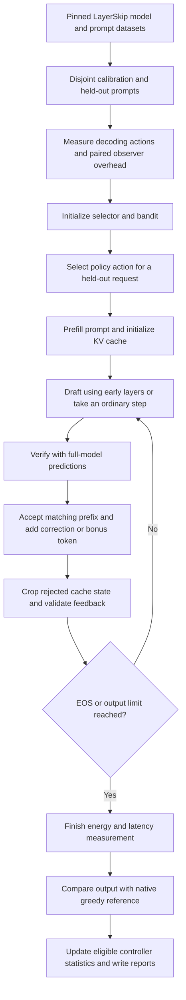

# Project explanation and professor discussion guide

Prepared from the current source code and saved `latest.json` / `latest.md`. This is a study guide for explaining the work, not a claim of publication-ready novelty. The saved results are a snapshot; rerunning the default command overwrites them.

## 1. A one-minute explanation

> Our project studies whether an LLM can generate the same greedy output with less measured GPU energy on a consumer laptop. We use an existing LayerSkip model, which drafts tokens using its early layers and verifies them using the full model. We built an experimental controller around this process to select the exit depth and draft length using measured energy, and to decide whether collecting extra intermediate-layer feedback is worth its cost. On our latest RTX 3050 run, adaptive decoding used 2.672 J per token compared with 4.129 J for ordinary decoding: 35.3% less GPU energy, with 42.3% lower time per token. All 381 measured requests matched the greedy reference. These results establish feasibility on our sample. We still need stronger fixed baselines and ablation experiments to establish the benefit of our controller and selective feedback.

Suggested working title: **Energy-Aware Self-Speculative Decoding with Selective Feedback on Consumer GPUs**.

## 2. The two papers and how they relate to our work

You identified From Bits to Chips and LayerSkip as the likely assigned papers. Their titles and research topics are verified below. Repository evidence confirms direct LayerSkip use; it does not independently establish which papers the professor assigned.

| Paper | Main idea | Relationship to this repository |
|---|---|---|
| **From Bits to Chips: An LLM-based Hardware-Aware Quantization Agent for Streamlined Deployment of LLMs**, Deng et al., 2026 | HAQA uses an LLM-based agent to automate quantization/deployment tuning with hardware considerations. | Motivation for hardware-aware configuration and feedback. The current controller chooses decoding settings; it is not an implementation of HAQA. |
| **LayerSkip: Enabling Early Exit Inference and Self-Speculative Decoding**, Elhoushi et al., ACL 2024 | Train a model for useful intermediate exits, then draft early and verify/correct using the remaining layers. | Direct technical foundation: pretrained LayerSkip checkpoint, split execution, and an attributed inference helper. |

Primary sources: [From Bits to Chips](https://arxiv.org/abs/2601.03484), [LayerSkip](https://arxiv.org/abs/2404.16710), and [official LayerSkip code](https://github.com/facebookresearch/LayerSkip).

A precise explanation of the connection is:

> We take hardware-aware tuning as motivation from From Bits to Chips and use LayerSkip as our inference foundation. Our present study applies measured hardware costs to decoding configuration and feedback collection. It is not yet a combined implementation of HAQA quantization and LayerSkip decoding.

The source exposes optional bitsandbytes INT4/INT8 loading, but it does not implement an LLM agent that searches quantization configurations. The latest experiment has `quantize: null` and uses FP32. Therefore, its gains cannot be attributed to quantization, distillation, or pruning.

**Other literature to know:** CALM appears in the original project direction, but its confidence-based compute allocation is not the current implemented pipeline. More directly relevant to novelty is **DEL: Context-Aware Dynamic Exit Layer for Efficient Self-Speculative Decoding** (2025): it already adapts exit layer and speculation length using acceptance information. Consequently, adaptive depth and draft length alone are not a defensible new research claim. See [CALM](https://arxiv.org/abs/2207.07061) and [DEL](https://arxiv.org/abs/2504.05598). This is a targeted literature check, not an exhaustive novelty review.

## 3. Essential concepts in plain language

| Term | Meaning in this project |
|---|---|
| Token | A unit of model text processing, often part of a word; not necessarily a whole word. |
| Inference | Running an already trained model to generate output. |
| Greedy decoding | Select the highest-scoring next token at each step. |
| Autoregressive generation | Each next token depends on the prompt and previously generated tokens. |
| Exit depth | How many early model layers the draft computation uses. |
| Draft length | How many candidate tokens are proposed before verification. |
| Self-speculation | One model acts as both drafter and verifier, using different portions of its layers. |
| KV cache | Stored attention keys and values that avoid recomputing the entire prefix. |
| Prefill | Initial processing of the prompt to prepare model state and caches. |
| Acceptance | Whether a proposed token agrees with the verifier on the valid current prefix. |
| Observer | Extra intermediate-exit prediction used as feedback, which also costs computation. |
| Calibration | Preliminary runs to measure action costs and observer overhead; no weight training here. |
| Policy | A rule for choosing decoding settings and observations. |
| Ablation | A controlled experiment removing one component to test whether it helps. |
| J/token | Joules of measured energy divided by generated tokens; lower is better. |
| ms/token | Measured request time divided by generated tokens; lower is better. |

Energy and power differ: power is the rate of energy use, measured in watts; energy is accumulated work consumption, measured in joules. A faster run can use less total energy without using less instantaneous power. These reports do not establish lower peak power or whole-laptop battery savings.

## 4. The actual pipeline



### Step A: Load an existing model

The main runner loads `facebook/layerskip-llama3.2-1B` at revision `81deb0f88734409cca506bcefcfb5c6bd2667565`. Our experiment does not perform the LayerSkip training recipe. Early-exit capability comes from the pretrained checkpoint.

### Step B: Prepare the workloads

GSM8K provides math prompts, and HumanEval provides code prompts. GSM8K train supplies calibration prompts and GSM8K test supplies held-out prompts. HumanEval IDs are shuffled into disjoint groups. Sources, revisions, hashes, and IDs are recorded. Inputs are truncated to 192 tokens.

In this experiment, these are **prompt workloads**, not scored quality benchmarks. We do not calculate GSM8K answer accuracy or execute HumanEval code.

### Step C: Calibrate actions and observers

An action is `(exit depth, draft length, observed exits)`. The default selector considers ordinary decoding plus depths `{4, 8, 12}` crossed with lengths `{1, 3}`: seven base actions.

The runner initially measures these actions on the first calibration prompt. It then measures same-prompt base/observed pairs and performs additional selector/bandit calibration. It does not exhaustively benchmark every action on every calibration prompt.

With the latest settings, the 45 measured calibration requests are:

- 7 initial base actions.
- 6 paired repetitions x 2 observation modes x 2 executions = 24 observer-calibration requests.
- 7 remaining calibration prompts x 2 controllers = 14 requests.

### Step D: Generate, verify, and roll back

Imagine the draft proposes `[A, B, C]`. The full-model verifier agrees with A and B but prefers D instead of C. We commit `[A, B, D]`, discard the rejected suffix, and crop its cached state. If all draft tokens match, the verifier can supply an additional bonus token. EOS and the output limit can shorten this process.

Verification exploits block processing and reused computation; it is not three completely separate full-model requests. Speculation still has overhead, and repeated rejections can erase its benefit.

### Step E: Use only valid feedback

An observer prediction at a position reached through rejected draft tokens is not evidence about the continuation we actually committed. `feedback.py` excludes those positions. A valid observation says what that exit predicted for **one next token on that prefix**; it does not tell us the energy or complete output of an unexecuted alternative configuration.

This distinction prevents misleading learning from hypothetical trajectories.

### Step F: Choose future actions from measured costs

The selector scores each action using observed cost per generated token, a noise term, and an acceptance-uncertainty penalty. It chooses the lowest score. This is a hand-designed statistical heuristic, not a neural controller, reinforcement-learning training system, or LLM-based agent.

Paid observations are offered only at depth 8 / length 3. After at least three calibration pairs, the controller compares a heuristic value of additional information against measured observation overhead. It can observe exit 4 or exits 4 and 12. This rule is not a calibrated prediction of future savings.

The independent-arm bandit is a simpler comparison using executed costs and exploration. Both controllers can learn from their own earlier held-out executions. Held-out therefore means unseen prompt IDs during calibration, not a completely frozen policy during evaluation.

### Step G: Check and record

Every measured request is compared token-for-token with a separate ordinary greedy reference. By default, mismatches are recorded and the configuration is excluded from subsequent adaptive/bandit choices. Fixed policies may still execute it. `--stop-on-mismatch` instead aborts.

Agreement is empirical evidence for these tested requests. It is not a proof for all prompts, precisions, hardware, or sampling modes. The reference and speculative path also share some low-level implementation, so an independent reference check would strengthen validation.

## 5. What we added, and what counts as novelty

A **project contribution** is something built or evaluated in this repository. A **novel research contribution** must also be meaningfully distinct from prior work and supported by experiments. The code alone cannot establish priority, authorship of every component, or publication novelty.

| Component | Defensible description | What is still needed |
|---|---|---|
| LayerSkip model and self-speculation | Reused research foundation with attribution | Do not claim to have invented or trained it |
| Energy-based action selection | Project-level controller using actual measured J/token for decoding decisions | Comparison with well-tuned fixed configurations and prior adaptive methods |
| Selective paid observations | Candidate research contribution: choose whether feedback is worth its measured cost | A matched comparison demonstrating that selective feedback helps |
| Committed-prefix filtering | Implemented validity rule for one-step observations | Ablation or analysis showing its effect; literature comparison |
| Paired observer-cost measurement | Experimental method making feedback overhead visible | More prompts, devices, seeds, and uncertainty estimates |
| Exact-output checks and mismatch exclusion | Correctness and experiment-integrity engineering | Broader validation and independent reference checks |
| Optional adaptive drafts, context selection, graphs, batching, GPU controls | Additional implemented or prototype experiments | Separate tests and measurements; these were off or absent from the latest run |

A suitable candidate contribution statement is:

> We investigate hardware-measured, energy-aware selection of self-speculative decoding configurations and cost-aware acquisition of valid intermediate-exit feedback on consumer GPUs.

Use **investigate** or **propose and evaluate a heuristic**, rather than “first,” “optimal,” or “state of the art.” DEL already overlaps with dynamic exit/draft selection. Whether the specific energy-and-feedback combination is novel requires a broader review and direct baseline comparisons.

## 6. Latest experiment: exact setup and results

Evidence: [latest.json](../hardware_aware_selective_feedback/results/latest.json) and [latest.md](../hardware_aware_selective_feedback/results/latest.md).

```powershell
python -m hardware_aware_selective_feedback.run `
  --device cuda `
  --objective energy `
  --calibration 4 `
  --test 8 `
  --tokens 64 `
  --repeats 3 `
  --observer-pairs 6
```

| Setting | Value |
|---|---|
| GPU | NVIDIA GeForce RTX 3050 Laptop GPU |
| OS | Windows 11 |
| Precision | FP32 |
| Runtime recorded in report | PyTorch 2.9.0+cu130; Transformers 5.18.0 |
| Energy sensor | NVML cumulative GPU energy counter |
| Boundary | NVIDIA GPU only |
| Calibration | 4 prompts per dataset = 8 total |
| Held-out evaluation | 8 prompts per dataset = 16 total |
| Repeats | 3 per held-out prompt |
| Output budget | Up to 64 generated tokens; all held-out requests in this run reached 64 |
| Seed | 42 |
| Measured requests | 45 calibration + 336 held-out = 381 |
| Correctness | 381/381 greedy matches; zero recorded mismatches |

The seven held-out policies each run 16 x 3 = 48 requests and generate 3,072 tokens.

| Policy | Configuration | ms/token | J/token | Energy reduction vs ordinary |
|---|---|---:|---:|---:|
| ordinary | Full-model greedy | 105.173 | 4.129220 | Reference |
| fixed | Depth 4, length 3 | 64.210 | 2.784979 | 32.6% |
| never_observe | Depth 8, length 3 | 63.219 | 2.764236 | 33.1% |
| selected_observe | Depth 8, length 3; observe 4 | 70.298 | 3.112311 | 24.6% |
| always_observe | Depth 8, length 3; observe 4 and 12 | 72.359 | 3.214446 | 22.2% |
| bandit | Independent-arm selection | 65.241 | 2.791580 | 32.4% |
| adaptive | Joint action/observation heuristic | 60.672 | 2.671720 | 35.3% |

All policies had zero greedy mismatches. Aggregated per-token metrics divide total measured cost by total generated tokens; they are not median request metrics.

### Know how to calculate the headline numbers

```text
Energy reduction = (1 - adaptive J/token / ordinary J/token) x 100
                 = (1 - 2.671720 / 4.129220) x 100 = 35.3%

Latency reduction = (1 - 60.671979 / 105.172984) x 100 = 42.3%

Throughput ratio = ordinary ms/token / adaptive ms/token
                 = 105.172984 / 60.671979 = 1.73x
```

Ordinary throughput was about 9.51 tokens/s; adaptive throughput was 16.48 tokens/s. A 42.3% latency reduction corresponds to about 73.3% higher throughput, not 42.3% higher throughput.

Adaptive energy was also 4.1% lower than `fixed`, 3.3% lower than `never_observe`, and 4.3% lower than `bandit` in these aggregates. Those smaller margins need repeated experiments and uncertainty analysis.

### What the adaptive controller actually did

Of the 48 held-out adaptive requests:

- 47 used depth 12 / draft length 3.
- 1 used depth 8 / draft length 3.
- None bought extra observer feedback.

This is crucial: the adaptive policy mostly settled on one configuration. The reported gain over ordinary decoding includes the benefit of LayerSkip speculation itself; it does not isolate the value of our selector.

The current held-out fixed baselines are depth 4 / length 3 and depth 8 / length 3. There is **no separately measured fixed depth-12 / length-3 policy across all held-out requests** in this report. That baseline is needed to determine whether adaptation improves on simply choosing depth 12 once.

### What we learned about observation cost

Relative to `never_observe` on matched prompt/repeat pairs, median additional energy was:

- Selected observer: 21.680 J per request.
- All observers: 28.613 J per request.

These are total-request paired differences, not J/token and not confidence intervals. Both observation policies had worse aggregate energy than the unobserved depth-8 baseline.

The report found `fixed` best on 9 prompts and `never_observe` best on 7 among the evaluated ordinary/fixed/never-observe candidates. This shows variation among those measured baselines, not proof that every possible optimal configuration varies by prompt; depth 12 was not part of that complete fixed comparison.

### Measurement boundaries and calibration cost

Measured request cost includes prefill, generation, and work within the generation function, including observation processing when enabled. It excludes model loading, native-greedy reference runs, and selector decisions outside that measured call. GPU synchronization brackets the measurement. The counter measures GPU energy, not CPU/RAM/display energy or total application energy.

Calibration cost was **8,991.701 J**, reported separately and not allocated to a policy. Do not subtract it from one policy selectively or call the 35.3% figure a whole-experiment net saving. A deployment comparison needs a consistent preparation-cost budget and enough requests to amortize it.

## 7. What improved relative to the earlier saved run?

The earlier reference is [rtx3050-fp32-energy-safe.md](../hardware_aware_selective_feedback/results/benchmark/rtx3050-fp32-energy-safe.md).

| Metric | Earlier reference | Latest run |
|---|---:|---:|
| Calibration prompts | 4 | 8 |
| Held-out prompts | 8 | 16 |
| Repeats per held-out prompt | 2 | 3 |
| Maximum output tokens | 16 | 64 |
| Observer pairs per mode | 2 | 6 |
| Measured greedy matches | 133/133 | 381/381 |
| Ordinary J/token | 4.392223 | 4.129220 |
| Adaptive J/token | 3.482609 | 2.671720 |
| Adaptive energy reduction within each run | 20.7% | 35.3% |
| Adaptive latency reduction within each run | 32.8% | 42.3% |
| Adaptive throughput relative to ordinary | 1.49x | 1.73x |

The latest run expands the workload and retains exact agreement on the measured requests. Its within-run differences are larger. **This is not a controlled before/after software comparison:** prompt counts, output lengths, repeats, runtime/environment, and possibly code differ. Longer generation can amortize prefill differently. Do not attribute the change from 20.7% to 35.3% to a particular code optimization without a matched experiment.

## 8. Implemented options versus what this run tested

| Feature | Status relevant to this presentation |
|---|---|
| FP32 LayerSkip generation and energy selection | Used in latest run |
| Paired observation-cost calibration | Used in latest run |
| Adaptive request-level policy | Used; distinct from the optional adaptive-draft flag |
| INT4/INT8 quantization | CLI support; disabled in latest run |
| Adaptive draft-length fallback | Implemented option; disabled |
| Context-specific selector tables | Implemented option; disabled |
| CUDA Graph draft replay | Prototype option; disabled; GPU capture/performance needs validation |
| torch.compile | Optional wrapper; disabled |
| GPU clock/power controls | Optional controls; disabled |
| Prompt batching | Ordinary baseline in sweep; not part of latest run |
| Batched speculative decoding | Not implemented |
| Qwen3 distillation | Earlier separate scripts; not part of this experiment |
| CALM-style pipeline or HAQA agent | Not implemented in the current experiment |

See [EFFICIENCY_CHANGES.txt](efficiency-changes.txt) for development notes. Historical measurements in that file belong to their own workloads and must not be presented as causes of the latest result.

## 9. Likely professor questions and answers

**What is your research question?**

Can measured GPU energy guide self-speculative decoding configuration, and can selectively collecting valid intermediate-layer feedback improve efficiency after paying its cost?

**What did your team build beyond running LayerSkip?**

The project adds the measured-cost controller, observation-cost calibration and selection, committed-prefix feedback validation, comparative experiment runner, and reporting/correctness checks. These are project contributions; their research novelty and independent benefit still require evaluation.

**Did you train a new model?**

No. The main experiment uses an existing exit-trained LayerSkip checkpoint. Calibration updates controller statistics, not neural network weights. Separate Qwen distillation scripts are earlier work.

**How does From Bits to Chips appear in the implementation?**

It motivates hardware-aware tuning. The present system tunes decoding actions from hardware measurements. It does not implement HAQA's LLM-based quantization/deployment agent, and the latest run is unquantized FP32.

**How can skipping layers preserve output?**

We use early layers to propose tokens, then verify with full-model predictions and correct disagreements. We are not committing every early-exit prediction without verification.

**Why not always use the shallowest exit or the longest draft?**

Shallow drafts may be cheaper but less accurate; long drafts can waste work after rejection. The best energy tradeoff depends on accepted tokens per cycle and actual hardware cost.

**Does 381/381 mean 100% task accuracy?**

No. It means identical token sequences to our greedy reference for those measured requests. The underlying model can still produce an incorrect mathematical answer or program.

**Did selective feedback cause the energy gain?**

We have not shown that. The held-out adaptive policy bought no observations, although it had received observation information during calibration. We need a matched no-feedback controller to isolate calibration feedback, and a matched selective-feedback ablation to test observation decisions.

**Is never_observe already that ablation?**

No. It is fixed at depth 8 / length 3. Comparing it to adaptive mixes configuration choice with observation behavior. A proper ablation holds the controller and available actions constant while changing only feedback access.

**Is the method better than the best fixed configuration?**

Not established. The latest controller mostly chose depth 12 / length 3, which lacks a full matched fixed-policy baseline in this report.

**Why call it hardware-aware?**

It measures cost on the executing hardware rather than assuming fewer operations always mean less energy. The current evidence is from one GPU; cross-device benefit is not established.

**Are the results statistically significant?**

The current report does not establish significance or provide confidence intervals. Three repeats share prompt content and should not be treated as 48 independent prompt samples. More independent runs and prompt-level paired analysis are needed.

**Can you reproduce it from requirements.txt?**

Not exactly as recorded: the report uses PyTorch 2.9.0+cu130 and Transformers 5.18.0, while requirements.txt pins 2.6.0 and 4.50.0. Archive the actual environment, driver, code revision/diff, command, and reports before claiming full reproducibility.

**Is this ready to call a new algorithm?**

It is an implemented heuristic and an experimental research direction. We need a broader literature comparison, a precise difference from prior adaptive methods, and controlled evidence for each proposed component.

## 10. Highest-value next experiments

1. **Measure fixed depth 12 / draft length 3 on every held-out prompt.** Use matched prompts, token limits, repeat counts, and randomized order. This is the most immediate missing baseline.
2. **Isolate the feedback contribution.** Compare the same controller and action set with no extra observations, selective observations, and always-on observations. Separate calibration feedback from held-out feedback. Allocate preparation costs consistently.
3. **Choose the best fixed configuration using calibration only.** Evaluate it on held-out prompts. Label any fixed choice selected using held-out results as an oracle analysis, not a deployable baseline.
4. **Repeat with more prompt IDs and seeds.** Preserve paired comparisons and report variability or confidence intervals over prompts; account for repeated requests and run-to-run effects.
5. **Report end-to-end cost as well as generation cost.** Include controller overhead and amortized preparation cost where relevant; keep energy boundaries consistent.
6. **Compare against relevant adaptive prior work, including DEL.** Use comparable hardware, precision, workloads, and correctness requirements. Paper speedup numbers alone are not a fair baseline.
7. **Evaluate quantization separately if it remains part of the assignment.** Compare quantized speculation with greedy decoding of the same quantized model, and assess quality changes versus FP32 separately. Design an actual hardware-aware quantization search if the aim is to implement HAQA-style functionality.
8. **Freeze the experimental artifact.** Save uniquely named reports, environment versions, device/driver details, and the exact code state. Align documented installation steps with the validated runtime.

These experiments may show that a fixed configuration is enough, that observers are too expensive, or that adaptation helps only some workloads. Each outcome is useful if the comparison is fair and the claim follows the evidence.

## 11. A five-minute presentation order

| Time | Explain or show |
|---|---|
| 0:00-0:40 | Problem: reduce measured inference energy while preserving greedy output |
| 0:40-1:20 | The two papers and what was reused versus inspired |
| 1:20-2:10 | Pipeline; explain the A/B/C draft and A/B/D correction example |
| 2:10-3:10 | Exact setup, policy table, and 35.3% / 42.3% / 381-of-381 figures |
| 3:10-4:10 | Candidate contribution; observers were not used during held-out adaptive requests; missing depth-12 baseline |
| 4:10-5:00 | Next experiments and what evidence would strengthen the contribution |

A defensible closing sentence:

> We have a working, measured implementation with promising exact-output results on our test sample. The next research step is to determine how much benefit comes from configuration selection and selective feedback beyond a strong fixed LayerSkip baseline.

## 12. Where to look when asked about the code

| File | What to explain |
|---|---|
| [run.py](../hardware_aware_selective_feedback/run.py) | Data splits, calibration, seven policies, randomized execution order, reports |
| [engine.py](../hardware_aware_selective_feedback/engine.py) | Draft/verify/commit loop, native greedy, cache rollback |
| [selector.py](../hardware_aware_selective_feedback/selector.py) | Cost scoring, observer heuristic, independent-arm bandit |
| [feedback.py](../hardware_aware_selective_feedback/feedback.py) | Validity of one-step observations on committed prefixes |
| [measurement.py](../hardware_aware_selective_feedback/measurement.py) | Synchronization, counter readings, energy boundaries |
| [sweep.py](../hardware_aware_selective_feedback/sweep.py) | Fixed-configuration comparisons and batched ordinary baselines |
| [vendor helper](../hardware_aware_selective_feedback/vendor/self_speculation/llama_model_utils.py) | Attributed low-level split model execution |
| [latest.json](../hardware_aware_selective_feedback/results/latest.json) | Arguments, runtime, raw rows, aggregates, paired deltas, mismatches |
| [latest.md](../hardware_aware_selective_feedback/results/latest.md) | Short generated results table |

The JSON preserves measured request rows and summary statistics, but it is not a complete archive of every intermediate activation or every cycle trace. Keep the vendored helper's [license and attribution](../hardware_aware_selective_feedback/vendor/LICENSE.LayerSkip).
